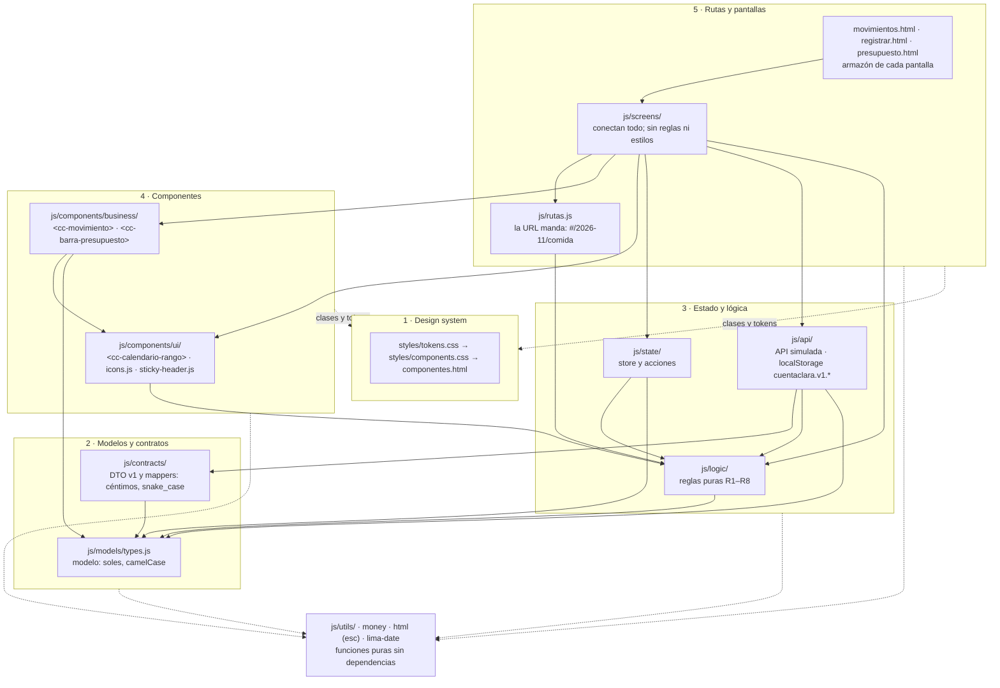
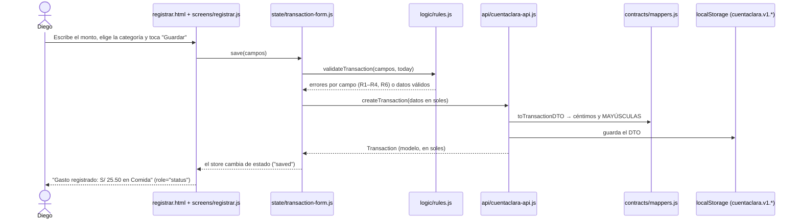

# Arquitectura de CuentaClara

CuentaClara es HTML, CSS y JavaScript con módulos ES (`<script type="module">`), sin frameworks, librerías ni build. El código se ordena en **5 capas**, y las dependencias van en una sola dirección: cada capa solo usa las de abajo. El grafo de abajo es el real: sale de los `import` de `js/`.

## 1. Diagrama de capas



Las flechas se leen "usa". Ninguna flecha sube: un componente nunca importa la API ni el store, y la lógica nunca toca el DOM.

## 2. Qué hace cada capa

| Capa | Carpeta | Qué hace | Puede usar | Nunca |
|---|---|---|---|---|
| 1 · Design system | `styles/`, `componentes.html` | Tokens en 3 capas (primitivo → semántico → componente), clases BEM y la vitrina con cada componente en cada estado | — | Colores hex fuera de `tokens.css` (un hook lo bloquea) |
| 2 · Modelos y contratos | `js/models/`, `js/contracts/` | Tipos del dominio y contrato v1. `mappers.js` es el único que convierte DTO ↔ modelo (céntimos ↔ soles, `MAYÚSCULAS` ↔ `minúsculas`) | `utils/` | DOM, `localStorage` |
| 3 · Estado y lógica | `js/logic/`, `js/state/`, `js/api/` | Reglas puras (`validateTransaction`, `canEdit`, `buildBudgetRows`, `budgetSummary`), el store con sus acciones y la API simulada | Capas 2 y `utils/` | `new Date()` en `logic/` (`today` llega como parámetro) |
| 4 · Componentes | `js/components/business/`, `js/components/ui/` | Custom elements sin Shadow DOM: reciben datos por propiedades y avisan con eventos `cc-*` | `logic/`, `models/`, `utils/`, los de `ui/` | La API, el store y las rutas |
| 5 · Rutas y pantallas | `*.html`, `js/screens/`, `js/rutas.js` | La página es solo armazón; su pantalla conecta ruta → acciones → store → pintar → eventos | Todo lo de abajo | Reglas de negocio y estilos propios |

`js/utils/` son funciones puras que usan todas las capas: dinero (`toCents`, `toSoles`, `formatMoney`), escape de HTML (`esc`) y fechas en hora de Lima (`todayInLima`, `formatDayLong`…).

## 3. Árbol de carpetas

```text
CuentaClara/
├── index.html                  lleva a movimientos.html (Live Server lo abre primero)
├── movimientos.html            HU-01 · armazón
├── registrar.html              HU-02 · armazón
├── presupuesto.html            HU-03 · armazón
├── perfil.html                 HU-04 (añadido) · armazón
├── componentes.html            vitrina del design system
├── styles/
│   ├── tokens.css              primitivos → semánticos → componente (claro y oscuro)
│   └── components.css          clases BEM, un solo breakpoint de ancho (48rem)
├── js/
│   ├── models/types.js         2 · tipos y categorías
│   ├── contracts/              2 · dto.js (contrato v1) · mappers.js
│   ├── logic/                  3 · rules.js · summary.js · period.js · budget.js
│   ├── api/                    3 · cuentaclara-api.js (única puerta a localStorage) · theme-boot.js
│   ├── state/                  3 · store.js · transactions.js · transaction-form.js · budget.js
│   ├── components/
│   │   ├── business/           4 · cc-movimiento.js · cc-barra-presupuesto.js
│   │   └── ui/                 4 · cc-calendario-rango.js · icons.js · sticky-header.js · theme.js
│   ├── screens/                5 · una por página, con el mismo nombre
│   ├── rutas.js                5 · rutas compartibles (#/2026-11/comida)
│   └── utils/                  money.js · html.js · lima-date.js
├── tests/                      igual que js/: api/ · contracts/ · logic/ · state/ · rutas.test.js
├── datos/                      movimientos.json · presupuestos.json (semilla del contrato v1)
├── scripts/                    expandir-iconos.mjs · verificar-hu03.mjs
├── specs/hu-03/                spec → plan → tasks (AI-First)
└── docs/                       historias, contrato, design system, UX, bitácora, prompts
```

## 4. Un dato de punta a punta: registrar un gasto



El tema es la única excepción al flujo por módulos: `js/api/theme-boot.js` es un script clásico y síncrono que cada página carga en su `<head>`. Aplica el tema guardado antes de pintar, porque un módulo llegaría tarde y se vería un instante el tema equivocado. Vive en la capa de API, así que las páginas siguen sin tocar `localStorage`.

La pantalla crea la API (`createBrowserApi()`) y se la pasa a las acciones (`createFormActions(api, today)`). Por eso el estado no importa la API. En las pruebas se usa `createApi()` con un almacenamiento en memoria, sin navegador.

## 5. Qué lo garantiza

| Regla | Dónde se cumple | Cómo se comprueba |
|---|---|---|
| Las dependencias solo bajan | Imports relativos de `js/` | El grafo de la sección 1 sale de los imports reales |
| `localStorage` solo en `js/api/` | `cuentaclara-api.js` (claves `cuentaclara.v1.*`) | Grep en `*.html` y `js/screens/`: 0 usos |
| Reglas puras con `today` como parámetro | `js/logic/` | Las pruebas fijan `today` y no dependen del reloj |
| Montos en céntimos en el contrato y en soles en el modelo | `js/contracts/mappers.js`, `js/utils/money.js` | `tests/contracts/contracts.test.js` |
| Componentes sin API ni store | `js/components/` | Solo importan `logic/`, `models/`, `utils/` y `ui/` |
| `// @ts-check` en todo `js/` | Primera línea de cada archivo | `scripts/verificar-hu03.mjs` (HU03-14) |
| Sin colores hex fuera de tokens | `styles/tokens.css` | Hook `guardian-tokens.mjs` y grep |

## 6. Pruebas

`node --test` (Node LTS) encuentra los archivos `tests/**/*.test.js`. Las pruebas se ordenan por capa, igual que `js/`:

| Carpeta | Qué prueba |
|---|---|
| `tests/logic/` | Reglas R1–R8, totales y filtros, períodos y presupuesto (estados de R5, urgencia y resumen) |
| `tests/contracts/` | Mappers DTO ↔ modelo y conversión de dinero |
| `tests/api/` | API simulada: crear, editar con PATCH, eliminación lógica, presupuestos y errores |
| `tests/state/` | Store y acciones, incluida la protección contra respuestas que llegan tarde |
| `tests/rutas.test.js` | Rutas compartibles y su corrección |
